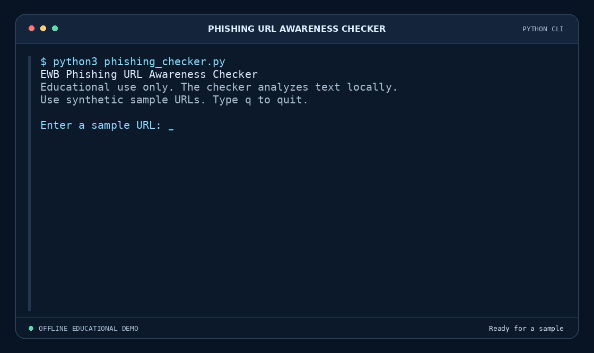

# Phishing URL Awareness Checker

## Overview

Phishing uses deceptive messages or links to trick people into sharing sensitive information. This offline Python tool examines URL text, displays the parsed hostname, and highlights visible warning signs without opening the link. It is designed for cybersecurity awareness and classroom practice.

## Features

- Detects an `@` in the URL authority, where user information can make the hostname harder to spot.
- Flags URLs longer than 100 characters after trimming surrounding whitespace.
- Identifies IPv4 and IPv6 addresses used as hostnames.
- Flags hostnames with five or more dot-separated labels.
- Highlights Unicode hostnames and Punycode-style labels that start with `xn--`.
- Flags explicit `http://` and reports a missing scheme separately.
- Shows the parsed hostname, warning count, and individual findings.
- Handles malformed input and lets users check multiple samples in one session.

## Requirements

- **Python 3.10 or later**
- **No third-party packages.** [`requirements.txt`](requirements.txt) documents the built-in modules used.

## How to Run

Open a terminal in the folder containing `phishing_checker.py`.

**Windows**

```powershell
python phishing_checker.py
```

**macOS or Linux**

```bash
python3 phishing_checker.py
```

Enter a sample URL and press **Enter**. Type `q` to exit.

## Output

```text
Enter a sample URL: http://192.0.2.10/account

Result:
- Parsed hostname: '192.0.2.10'
- REVIEW CAREFULLY: 2 warning sign(s) found.
- Uses an IPv4 address instead of a domain name.
- Uses HTTP. HTTPS alone does not prove trust.
```

## Testing

The five workbook samples below were verified with Python 3.12.14.

| # | Input | Expected | Actual | Result |
| --- | --- | --- | --- | --- |
| 1 | `https://www.example.com/login` | No listed warnings | No listed warnings. A safety reminder appeared. | PASS |
| 2 | `http://192.0.2.10/account` | IP and HTTP warnings | IPv4 and HTTP warnings appeared. | PASS |
| 3 | `http://example.com@sample.invalid/login` | Authority `@` and HTTP warnings | Both warnings appeared. The parsed hostname was `sample.invalid`. | PASS |
| 4 | `https://a.b.c.d.e.example.invalid/path` | Hostname segments warning | The checker reported seven labels. | PASS |
| 5 | `https://xn--example.invalid/` | Punycode-style label warning | The Punycode-style label warning appeared. | PASS |

Additional checks covered empty input, malformed input, IPv6, invalid IPv4-like input, an `@` in the path, a missing scheme, and the 100- and 101-character length boundary.

## Screenshots

The animated terminal demo shows a result with two warnings, a malformed input error, and a result with zero listed warnings.



## Improvements

1. **Continuous checking.** The prompt accepts multiple samples in one session. Verified by checking several URLs and typing `q` to exit.
2. **Malformed input handling.** The checker reports incomplete URLs and invalid ports without ending the session. Verified by entering `http://[bad` and then checking a valid sample.
3. **More precise hostname checks.** The checker recognizes IPv6 and checks `@` only in the URL authority. Verified with a bracketed IPv6 sample and inputs containing `@` in the authority and path.

## Limitations

The checker analyzes visible URL text. It cannot inspect website content, redirects, certificates, or domain reputation. A legitimate URL can trigger warnings, and **zero listed warnings does not prove a URL is safe**.

## Ethical Use

Use synthetic examples or the workbook's sample URLs for defensive learning. Keep credentials, private links, and personal data out of test inputs, screenshots, and public repositories. Use the project for awareness and authorized practice.

## Author

**Dhruv Khatri**  
Cybersecurity mini project.

© 2026 Dhruv Khatri. All rights reserved.
